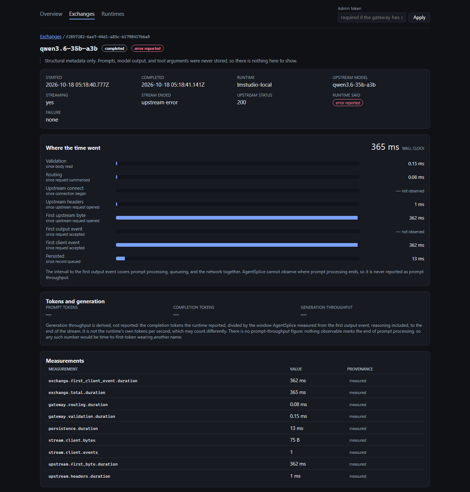

# AgentSplice

**A local flight recorder for AI coding agents and LLM runtimes.**

[](https://github.com/murillojndem/agent-splice/actions/workflows/ci.yml)
[](https://github.com/murillojndem/agent-splice/releases)
[](LICENSE)
[](https://dotnet.microsoft.com/download/dotnet/10.0)

Your agent says `UnknownError`. The runtime says `200 OK`. AgentSplice sits between them and records
what actually happened: where each request's time went, how its stream ended, and whether the runtime
really succeeded — without storing a single prompt.

- **No SDK, no code changes.** Point an OpenAI-compatible client at `http://127.0.0.1:5280/v1`.
- **Streams pass through as they arrive.** A stream's bytes are relayed verbatim and timed on the way:
  first byte, first event, first output event, first flush to the client.
- **Evidence, not guesses.** Every number says whether AgentSplice measured it, the runtime reported
  it, or it was derived from both.
- **Private by default.** Counts, shapes, and timings — never prompts, output, or tool arguments.
- **Local-first.** One process on loopback, SQLite, a built-in dashboard, optional OpenTelemetry
  export.



The dashboard on a stream the runtime answered `200` and then failed, recorded as the runtime's failure
rather than as a success. From synthetic data ([more screens](docs/images/README.md)).

## What a real session showed

On 2026-10-17, OpenCode 1.18.7 ran a small coding task through AgentSplice to LM Studio 0.4.20 on one
Windows machine with a Radeon RX 7900 XT. The gateway was a CI build from before the first release.
[The trace report](docs/reports/2026-10-17-opencode-lm-studio/README.md) has every exchange; three
things stood out.

1. **A `200` that was not a success.** LM Studio answered OpenCode's agent request `200`, sent a single
   1,098-byte event, and closed the stream without `[DONE]`. OpenCode showed `UnknownError`. LM Studio's
   own log named the cause: the model's chat template uses a `safe` filter that LM Studio's template
   engine does not have (`Unknown StringValue filter: safe`). That build recorded an ordinary
   completion; AgentSplice now records the runtime's failure
   ([ADR 0026](docs/adr/0026-stage-1d-a-runtime-error-inside-a-success-is-the-runtimes-failure.md)).
2. **Where the agent's first minute went.** OpenCode sent its session-title request beside its first
   agent step, and LM Studio served one request at a time. The title came first and took 1,881 tokens
   and 38.6 s, because the model reasons before it answers. AgentSplice's timeline showed the agent
   step's headers within 6 ms and then a minute of silence; LM Studio's log showed why: the request
   waited behind the title, then its long prompt was processed. At 60 s AgentSplice's own idle timeout
   cut it, and OpenCode retried without a word in the session; the retry took 13.2 s. The wait before a
   stream's first byte now has a budget of its own, 5 minutes
   ([ADR 0028](docs/adr/0028-the-wait-for-a-streams-first-byte-has-its-own-budget.md)); by the recorded
   timings that request would have finished, though the session was not run again.
3. **What the recorder cost, and what it kept.** AgentSplice flushed each stream's first event to
   OpenCode within 2 ms of receiving it, and within 0.25 ms for 6 of 7 streams. Random markers placed
   in each prompt were found nowhere in its log, its SQLite store, or the evidence exported from its API.

One machine, one task, one build: evidence of what happened, not a compatibility claim.

## Quickstart

About two minutes once LM Studio has a model. AgentSplice is an experimental alpha; see
[what it is not, yet](#what-it-is-not-yet).

1. **Start LM Studio's server and load a model** with room for an agent's prompt, in LM Studio's
   Developer tab or with its `lms` command:

   ```bash
   lms server start --port 1234
   lms load <model-id> --context-length 32768
   ```

2. **Start AgentSplice**, whichever way suits you. Each listens on `http://127.0.0.1:5280`, and
   [Installing AgentSplice](docs/INSTALLATION.md) covers every step in detail.

<details>
<summary><b>Windows</b> (x64): a self-contained package, no .NET and no Docker</summary>

In PowerShell, download the package and its checksums, and check the digest. The last line must print
`True`:

```powershell
curl.exe -fLO https://github.com/murillojndem/agent-splice/releases/download/v0.2.2-alpha/agentsplice-0.2.2-alpha-win-x64.zip
curl.exe -fLO https://github.com/murillojndem/agent-splice/releases/download/v0.2.2-alpha/SHA256SUMS
$zip = 'agentsplice-0.2.2-alpha-win-x64.zip'
$expected = ((Select-String -Path SHA256SUMS -SimpleMatch $zip).Line -split '\s+')[0]
(Get-FileHash -Algorithm SHA256 $zip).Hash.ToLower() -eq $expected
```

Then extract it into a folder only your account can write, and start it:

```powershell
Unblock-File $zip
Expand-Archive $zip -DestinationPath "$env:LOCALAPPDATA\Programs\AgentSplice"
& "$env:LOCALAPPDATA\Programs\AgentSplice\agentsplice-0.2.2-alpha-win-x64\AgentSplice.Api.exe"
```

The package is not code-signed. If **Windows protected your PC** appears, choose **More info**, then
**Run anyway**.

</details>

<details>
<summary><b>Linux</b> (x64): a self-contained package, no .NET and no Docker</summary>

It needs a recent glibc-based distribution, not Alpine;
[the requirements](docs/INSTALLATION.md#linux-package) name the oldest that work. Download the package
and its checksums, and check the digest. The last line must print `…: OK`:

```bash
curl -fLO https://github.com/murillojndem/agent-splice/releases/download/v0.2.2-alpha/agentsplice-0.2.2-alpha-linux-x64.tar.gz
curl -fLO https://github.com/murillojndem/agent-splice/releases/download/v0.2.2-alpha/SHA256SUMS
archive=agentsplice-0.2.2-alpha-linux-x64.tar.gz
grep -F "  $archive" SHA256SUMS | sha256sum --check --strict -
```

Then extract it into a folder only your account can write, and start it:

```bash
mkdir -p ~/.local/opt/agentsplice && chmod 700 ~/.local/opt/agentsplice
tar -xzf "$archive" -C ~/.local/opt/agentsplice
~/.local/opt/agentsplice/agentsplice-0.2.2-alpha-linux-x64/AgentSplice.Api
```

</details>

<details>
<summary><b>macOS</b> (Apple silicon): a self-contained package, no .NET and no Docker</summary>

It needs a Mac with Apple silicon and macOS 15 or later; on an Intel Mac, use the image or the source,
below. Download the package and its checksums, and check the digest. The last line must print `…: OK`:

```bash
curl -fLO https://github.com/murillojndem/agent-splice/releases/download/v0.2.2-alpha/agentsplice-0.2.2-alpha-osx-arm64.tar.gz
curl -fLO https://github.com/murillojndem/agent-splice/releases/download/v0.2.2-alpha/SHA256SUMS
archive=agentsplice-0.2.2-alpha-osx-arm64.tar.gz
grep -F "  $archive" SHA256SUMS | shasum -a 256 --check --strict -
```

Then extract it into a folder only your account can write, and start it:

```bash
mkdir -p ~/.local/opt/agentsplice && chmod 700 ~/.local/opt/agentsplice
tar -xzf "$archive" -C ~/.local/opt/agentsplice
~/.local/opt/agentsplice/agentsplice-0.2.2-alpha-osx-arm64/AgentSplice.Api
```

The package is signed ad hoc, which names nobody, and Apple has not notarized it. `curl` sets no
quarantine mark, so it opens as it is. Downloaded with a browser, it can carry the mark, and macOS then
refuses to open it; once the digest has matched, clear the mark from the package's folder
([why](docs/INSTALLATION.md#if-macos-refuses-to-open-it)):

```bash
xattr -dr com.apple.quarantine ~/.local/opt/agentsplice/agentsplice-0.2.2-alpha-osx-arm64
```

</details>

<details>
<summary><b>Docker</b>: the published image</summary>

A container cannot tell that its port is published on loopback only, so there the gateway requires an
administrative token for its stored evidence. Choose one, and start the image:

```bash
export AGENTSPLICE_ADMIN_API_KEY="$(openssl rand -hex 32)"
echo "$AGENTSPLICE_ADMIN_API_KEY"   # paste this into the dashboard's token field
docker run --detach --name agentsplice \
  --publish 127.0.0.1:5280:5280 \
  --volume agentsplice-data:/data \
  --add-host host.docker.internal:host-gateway \
  --env 'AGENTSPLICE__PERSISTENCE__CONNECTIONSTRING=Data Source=/data/agentsplice.db' \
  --env AGENTSPLICE__RUNTIMES__0__BASEURL=http://host.docker.internal:1234/v1 \
  --env AGENTSPLICE__ADMINISTRATION__APIKEYENVIRONMENTVARIABLE=AGENTSPLICE_ADMIN_API_KEY \
  --env AGENTSPLICE_ADMIN_API_KEY \
  ghcr.io/murillojndem/agent-splice:0.2.2-alpha
```

Docker Desktop forwards `host.docker.internal` to the host. On a Linux engine, LM Studio must listen on
an address the container can reach, not on loopback alone. The same command in PowerShell, and Compose
from a clone, are in [Installing AgentSplice](docs/INSTALLATION.md#docker).

</details>

<details>
<summary><b>From source</b>: any platform with the .NET 10 SDK</summary>

```bash
git clone https://github.com/murillojndem/agent-splice.git
cd agent-splice
dotnet run --project src/AgentSplice.Api
```

A fresh clone has no dashboard build. The APIs work without one, and the
[development guide](docs/DEVELOPMENT.md#the-dashboard) shows how to build it and point the gateway at it.

</details>

3. **Check that it sees the model.** The `id` values listed are the model names a client sends:

   ```bash
   curl -s http://127.0.0.1:5280/v1/models
   ```

   ```powershell
   curl.exe -s http://127.0.0.1:5280/v1/models
   ```

   Without LM Studio's server, this answers `502` `agentsplice_runtime_unavailable`.

4. **Point a client at `http://127.0.0.1:5280/v1`**, with any placeholder as its API key:

   | Client | Configuration |
   | --- | --- |
   | OpenCode | [`examples/opencode/opencode.json`](examples/opencode/opencode.json), with your model ID |
   | Cline | API Provider **OpenAI Compatible**, with the fields in [Cline](docs/CLIENTS.md#cline) |
   | Any client or SDK that speaks OpenAI Chat Completions | [Base URL, `curl`, PowerShell, and Python](docs/CLIENTS.md#any-openai-compatible-client) |

5. **Open the dashboard** at `http://127.0.0.1:5280/dashboard/`, where completions appear as exchanges;
   a completion response's `x-agentsplice-exchange-id` names the one to open. Under Docker, paste the
   token into the dashboard's token field first.

[Pointing a client at AgentSplice](docs/CLIENTS.md) explains each setting and what to do when a request
fails.

### How long it waits

A local runtime can take minutes before it sends anything: a request queued behind another, a long
prompt being processed, reasoning it does not stream. AgentSplice waits up to 5 minutes for the
runtime's response headers and, on a stream, up to 5 more for its first byte; once bytes flow, up to 60
seconds between reads; and 10 minutes for the whole request. A request that is not streamed has those
first 5 minutes for the whole answer, because LM Studio 0.4.20 sends its headers only with the finished
answer. When a budget runs out before anything has reached the client, the client receives a `504`
`agentsplice_upstream_timeout`, and the exchange's timeline names the phase that fired. Once a stream
has started, a stall ends it instead, and the exchange records that too.

To wait longer, pass the phases on the command line. Here it is for the Windows package, from its
folder; the Linux and macOS packages, and `dotnet run --project src/AgentSplice.Api --`, take the same
arguments:

```powershell
.\AgentSplice.Api.exe --agentsplice:runtimes:0:timeouts:responseHeaders=00:08:00 --agentsplice:runtimes:0:timeouts:firstByte=00:08:00
```

Each phase must stay within the total, 10 minutes by default
(`--agentsplice:runtimes:0:timeouts:total`). [Troubleshooting](docs/CLIENTS.md#troubleshooting) covers
every phase, and how to set them under Docker.

## How it works

```text
  OpenCode, Cline, or any OpenAI Chat Completions client
                          |
                          |  http://127.0.0.1:5280/v1
                          v
  +-----------------------------------------------------------+
  |                        AgentSplice                        |
  |  forwards the request, relays the answer as it arrives    |
  |  times each boundary, classifies how the exchange ended   |
  |  keeps metadata only: SQLite, dashboard, OTLP (opt-in)    |
  +-----------------------------------------------------------+
                          |
                          |  the request body, byte for byte
                          v
  LM Studio   (llama.cpp, Ollama, vLLM, SGLang: planned)
```

AgentSplice serves `GET /v1/models` and `POST /v1/chat/completions`, streamed or not. It forwards each
request's body byte for byte — only an alias, if you configure one, renames the model — and relays the
runtime's answer as it arrives: its status, its body, and an allowlist of its headers. For every
exchange it records:

- **a timeline:** request accepted, validated, model resolved, request opened to the runtime, headers
  received, first byte, first event, first output event, first event flushed to the client, completion,
  and persistence, each read from AgentSplice's own clock;
- **how it ended:** `[DONE]` received, the stream closing without it, the client or the runtime
  cancelling, a timeout and its phase, a lost connection, a malformed event, a limit the gateway
  enforces, or an error the runtime reported inside its answer;
- **what the runtime said:** `success`, `error_status`, or `error_reported`, so a `200` that carried an
  error counts as the runtime's failure;
- **tool calls:** each native tool call the runtime emitted, counted and timed, never its arguments;
- **usage:** the tokens the runtime reported, labelled as reported, and the throughput derived from them.

Records go to a local SQLite store, kept for 30 days by default, and are served by the administrative
API under `/api/v1` and the dashboard at `/dashboard/`. Spans and metrics can be exported over OTLP,
which stays off until you turn it on ([Observability](docs/OBSERVABILITY.md)).

## What it is not, yet

- **An experimental alpha.** No compatibility claim is made for any client, model, or runtime: an HTTP
  `200` is not evidence of compatibility, and a support claim needs a dated conformance report
  ([Conformance](docs/CONFORMANCE.md)), of which none exists yet.
- **One protocol in.** OpenAI Chat Completions only: no `/v1/responses`, no embeddings, and no Anthropic
  Messages, so Claude Code cannot use it yet.
- **One runtime provider, three runtimes with evidence.** LM Studio, and llama.cpp's `llama-server` and
  Ollama through the same provider, each with a trace report
  ([`llama-server`](docs/reports/2026-10-19-opencode-llama-server/README.md),
  [Ollama](docs/reports/2026-10-19-opencode-ollama/README.md)). Other servers with an OpenAI-compatible
  `/v1`, such as vLLM, may work through it too, but nothing has been recorded with them.
- **No replay yet.** Replay, comparison across runtimes, conformance suites, and agent evaluation are the
  [roadmap](#roadmap), not this build.
- **No signed or notarized packages.** The Windows package is not code-signed, and the macOS one is
  signed ad hoc, for Apple silicon only, and not notarized; an Intel Mac runs the image, which is
  `linux/amd64` only.
- **No authentication on `/v1`.** The gateway listens on loopback by default and refuses a binding beyond
  it unless `/api/v1` has a token; `/v1` takes no credential either way. Without a token, the packages
  serve `/api/v1` and its evidence to every account on the machine ([Security](docs/SECURITY.md)).
- **Not a tool runner.** A tool call is recorded as data; AgentSplice never executes what a model asks
  for.

## When to use something else

Different jobs:

| You want to… | Look at |
| --- | --- |
| Route between cloud providers, with keys, budgets, retries, and fallbacks | LiteLLM, Portkey |
| Trace an LLM application's prompts and outputs, and evaluate them | Langfuse, Arize Phoenix |
| See raw HTTP as it crossed the wire | mitmproxy |
| Know where an agent's request spent its time against a local runtime, how its stream ended, and whether the runtime really succeeded, without keeping what was said | AgentSplice |

AgentSplice exports OpenTelemetry, so its spans and metrics can sit beside your other telemetry.

## Roadmap

| Stage | What it adds | Status |
| --- | --- | --- |
| 1 | The transparent trace proxy: this build | Released, 0.2.x |
| 2A | Sanitized replay artifacts: capture an exchange once, replay it later | In progress |
| 2B | Differential comparison: the same request against two runtimes, and what changed | Planned |
| 2C, 2D | Protocol, streaming, and tool-call conformance suites, with dated results | Planned |
| 2E | Cache evidence: whether a runtime reused the prompt prefix, and how sure that is | Planned |
| 3 | Agent evaluation: the same coding task across agents, models, and runtimes | Planned |
| 4 | Optional adapters, Anthropic Messages among them | Later |

[The roadmap](docs/ROADMAP.md) has each stage's scope and exit criteria. To hear when a release ships,
choose **Watch → Custom → Releases** at the top of this page. Which runtime or client should come next?
Say so in [Discussions](https://github.com/murillojndem/agent-splice/discussions).

## How it's built

- **Specification first.** [The specification](docs/SPECIFICATION.md) sets the requirements, every
  architectural decision is an [ADR](docs/adr/), and the [roadmap](docs/ROADMAP.md) ships one stage at
  a time.
- **Tests hold it to its documents.** Over 1,000 tests: unit tests, integration tests against a
  deterministic fake runtime, architecture tests for the module boundaries, and contract tests that fail
  when a document, this README included, names a setting, an error code, a header, or a command the code
  does not have. CI runs them on Windows and Ubuntu.
- **Reviewed against its own claims.** Three review passes over the request path and the streaming relay
  found ten defects CI had passed, two of them because a test asserted the defect as the contract
  ([ADR 0010](docs/adr/0010-correct-stream-boundary-and-termination-semantics.md),
  [ADR 0011](docs/adr/0011-per-event-bounds-and-media-type-parsing.md),
  [ADR 0012](docs/adr/0012-classification-independent-of-relayability.md)).
- **Releases you can check.** CI builds each release from its tag. A published release is immutable, and
  each of its assets is listed in `SHA256SUMS` and can be checked with `gh release verify-asset`.
- **Stack.** .NET 10 and ASP.NET Core, System.Text.Json, SQLite through Entity Framework Core, the
  OpenTelemetry SDK, and a React and TypeScript dashboard built with Vite.

The principles it holds to:

1. Evidence before workaround.
2. Transparent capture before transformation.
3. Replay and conformance before broad compatibility rewriting.
4. Local-first privacy and loopback-only defaults.
5. Never execute model-requested tools inside the core gateway.
6. Distinguish measured, reported, inferred, and estimated values.
7. Preserve streaming and cancellation semantics.
8. Treat transformations as explicit, versioned, auditable policies.
9. Treat AMD/ROCm and other non-CUDA environments as first-class evidence sources.
10. Upstream fixes when a defect belongs in another project.

## Documentation

- [Installing AgentSplice](docs/INSTALLATION.md): Docker, the Windows and Linux packages, and from source
- [Pointing a client at AgentSplice](docs/CLIENTS.md): OpenCode, Cline, any OpenAI-compatible client, and
  troubleshooting
- [Observability](docs/OBSERVABILITY.md): the timeline, the metrics, and what each measurement means
- [API contract notes](docs/API.md) and the [OpenAPI document](openapi/agentsplice-openapi.yaml)
- [Security](docs/SECURITY.md) and the [threat model](docs/THREAT_MODEL.md)
- [Trace reports](docs/reports/README.md) and the [compatibility matrix](docs/COMPATIBILITY_MATRIX.md)
- [Product positioning](docs/PRODUCT_POSITIONING.md), [architecture](docs/ARCHITECTURE.md), the
  [specification](docs/SPECIFICATION.md), and the [roadmap](docs/ROADMAP.md)
- The [replay](docs/REPLAY.md), [conformance](docs/CONFORMANCE.md), and
  [benchmarking](docs/BENCHMARKING.md) specifications
- [Development guide](docs/DEVELOPMENT.md): building, testing, packaging, and releasing
- [Changelog](CHANGELOG.md) and [portfolio brief](docs/PORTFOLIO_BRIEF.md)

## Contributing, security, and license

Bug reports, trace reports, and pull requests are welcome; [CONTRIBUTING.md](CONTRIBUTING.md) says what
a useful one includes. Questions and ideas go to
[Discussions](https://github.com/murillojndem/agent-splice/discussions). Report a vulnerability
privately, as [SECURITY.md](SECURITY.md) describes, never in a public issue.

AgentSplice is licensed under the [Apache License 2.0](LICENSE); see [NOTICE](NOTICE). The software it
bundles is listed with its licenses in [THIRD-PARTY-NOTICES.md](THIRD-PARTY-NOTICES.md).

If AgentSplice is useful to you, a GitHub star helps other developers find it.
